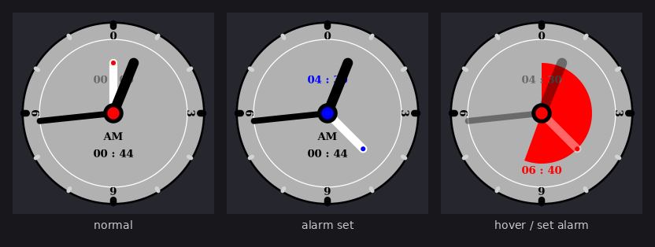

# gnome-shell-cairo

---

Cairo Clock for gnome-shell

**This is a maintained fork** of [eexpress/gs-clock](https://github.com/eexpress/gs-clock),
whose last release supports GNOME Shell 44. The extension is ported here to the
GNOME 45+ ESM extension API and runs on GNOME Shell 50: `Clutter.Canvas` ->
`St.DrawingArea`, `Clutter.Color` -> plain RGB values, clicks via
`Clutter.ClickGesture` (GNOME 48+ no longer delivers `button-press-event` to
actors). See [CHANGELOG.md](CHANGELOG.md) for the full list, and
[HACKING.md](HACKING.md) to build, test and port it further.

Install from a checkout with `bash pack.bash`, then log out and back in —
GNOME Shell only loads newly installed extensions at session start.

Import from `cairo-timer`

Click the clock face to set the alarm, click the center circle to enable the alarm.

单击钟面设置闹钟，单击中心圆启用闹钟。

Alt + click on main icon, background of icon become green, this enable Popup per hour function.

Alt+点击主图标，图标背景变为绿色，启用每小时弹出报时功能。

Ctrl + click on main icon, can test the alarm effect.

Ctrl+点击主图标，能测试闹钟的动态效果。

In case of alarm, the clock will swing dynamically.

如果闹钟响了，时钟会动态摆动。

GNOME 50 (St.DrawingArea) rendering:

Original author: `eexpress`. Special thanks `Simon Schneegans`.
