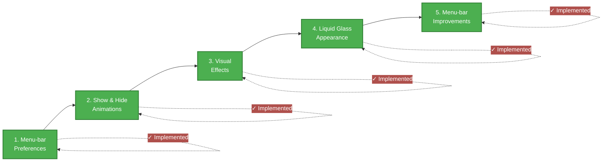
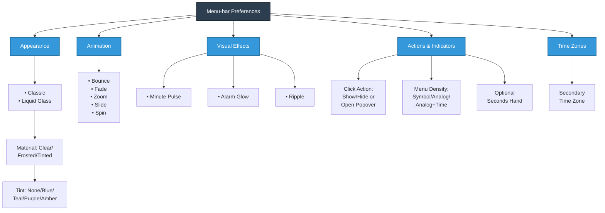
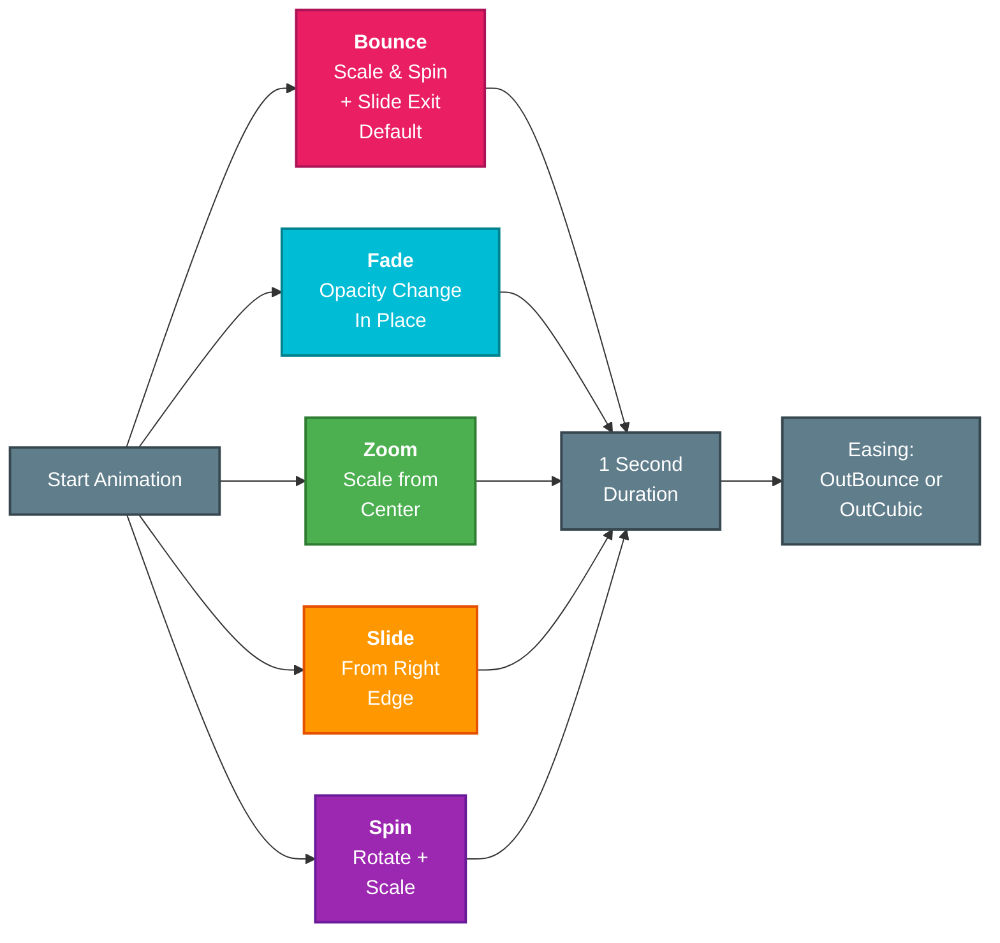
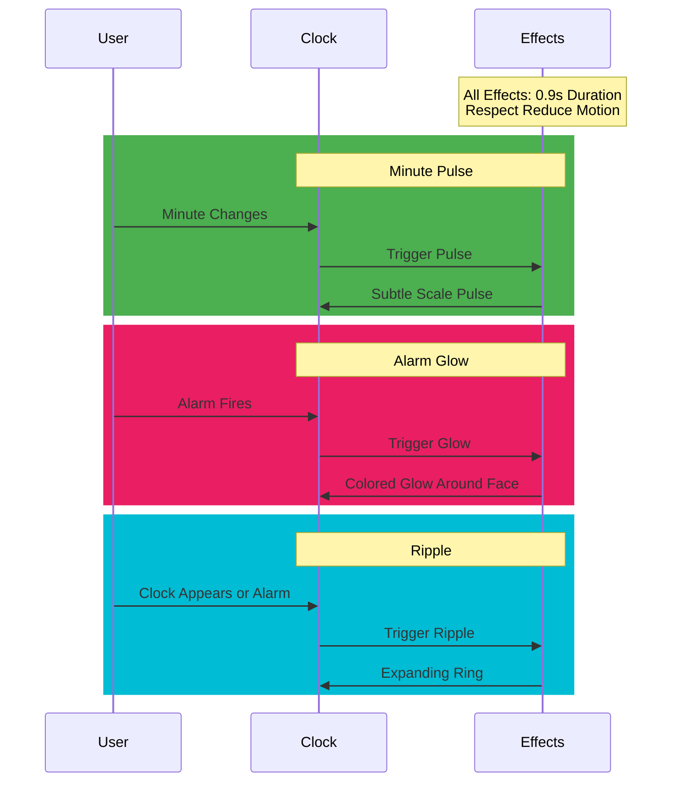
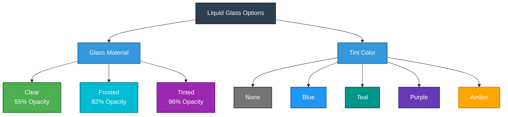
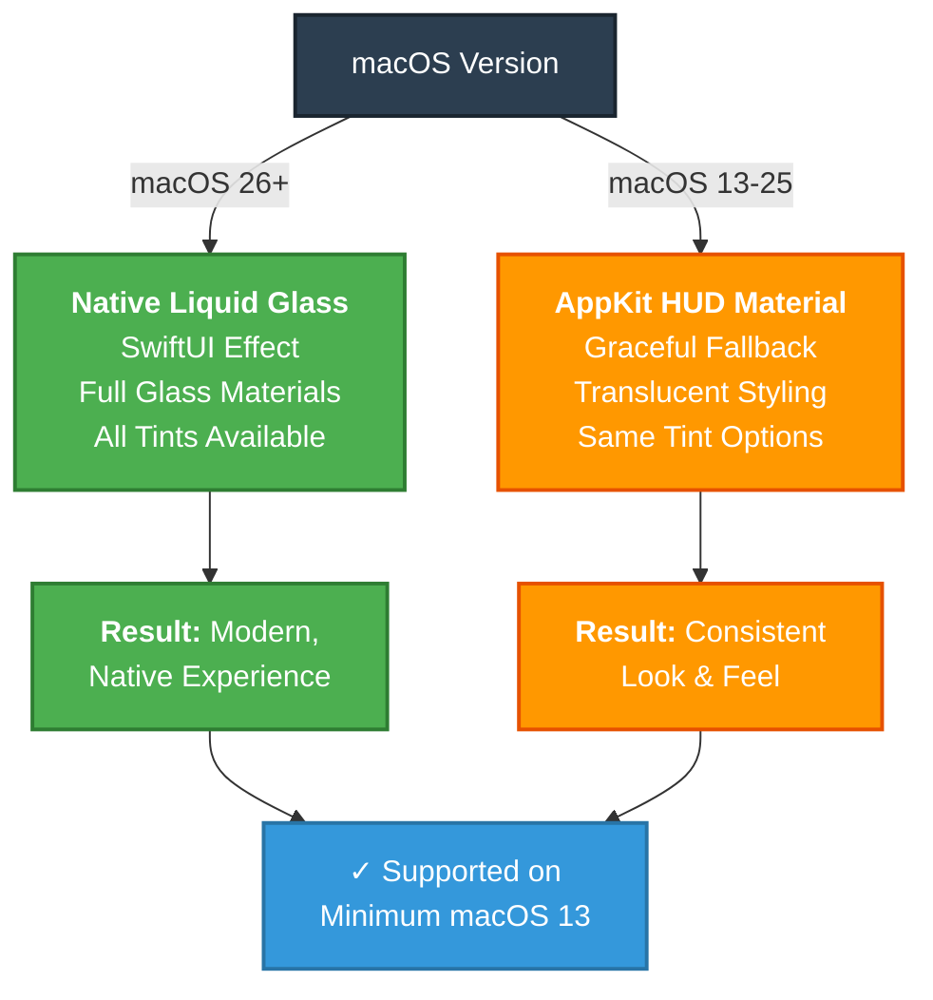
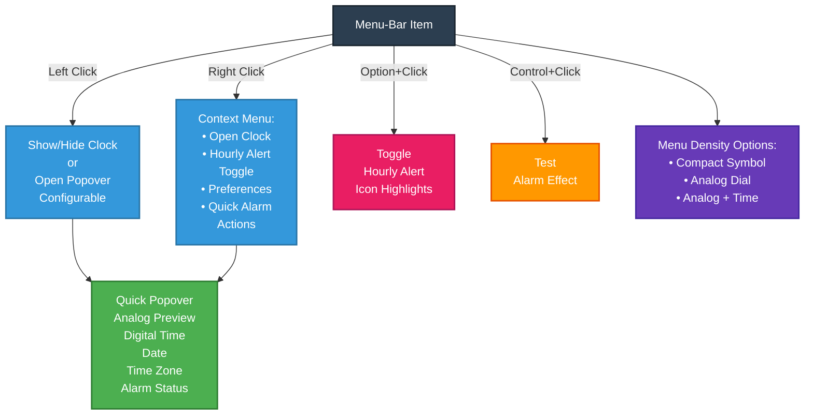

# Cairo Clock roadmap

The roadmap features below are implemented in the macOS app. Existing click
behavior, Option-click hourly alerts, Control-click alarm testing, and clock
face alarm controls remain available.

## 1. Menu-bar preferences

Right-click the menu-bar item for a context menu with an Hourly Alert toggle
and Preferences. A normal left click still shows or hides the clock.

Preferences include:

- The clock appearance and three optional visual effects.
- A show/hide animation choice: Bounce, Fade, Zoom, Slide, or Spin.
- Restore Defaults, which returns to the Classic appearance and Bounce
  animation, and disables optional effects and hourly alerts.

Settings are stored with `UserDefaults` and persist between launches.

## 2. Show and hide animations

The selected animation is used in both directions when the clock view is shown
or hidden, including hiding with a right-click on the clock face:

1. **Bounce** — the existing bouncing scale-and-spin entrance and slide-away
   exit.
2. **Fade** — fade the clock in and out in place.
3. **Zoom** — scale the clock in and out around its centre.
4. **Slide** — slide the clock in from, and back toward, the right edge.
5. **Spin** — rotate the clock while scaling it in and out.

Bounce remains the default to preserve the existing transition.

## 3. Optional visual effects

The effects are independent preferences and off by default:

1. **Minute pulse** — a brief, subtle pulse of the clock face when the minute
   changes. It is suppressed when Reduce Motion is enabled.
2. **Alarm glow** — a short colored glow around the face when an alarm fires,
   complementing the existing swing.
3. **Ripple** — a restrained expanding ring when the clock appears or an alarm
   fires. It is suppressed when Reduce Motion is enabled.

Effects use short-lived timers and do not intercept input or replace the
existing appear/disappear animation.

## 4. Liquid Glass appearance

The Preferences appearance selector offers **Classic** and **Liquid Glass**.
When Liquid Glass is selected, users can configure the glass material as Clear,
Frosted, or Tinted, and select None, Blue, Teal, Purple, or Amber tint. These
choices are saved with other preferences. The glass backdrop is drawn behind
the clock details so its hands, labels, hover indicator, and alarm display
stay legible.

### Glass Material & Tint Compatibility

| Material | Opacity | Tints Available | Use Case |
|----------|---------|-----------------|----------|
| **Clear** | 55% | All 5 options | Default, maximum transparency |
| **Frosted** | 82% | All 5 options | Balanced visibility & blur |
| **Tinted** | 96% | All 5 options | Enhanced color, less transparency |

On macOS 26 and later, the appearance uses SwiftUI's native Liquid Glass
effect. On macOS 13–25, it falls back to an AppKit HUD material while retaining
the translucent clock styling. The app's minimum deployment target remains
macOS 13.

## 5. Native menu-bar improvements

The recommendations below are now implemented:

- **Analog indicator and density:** the status item defaults to a compact
  custom analog dial, with Compact Symbol and Analog + Time options. An
  optional seconds hand is off by default; without it, the dial redraws on
  minute changes. The hourly-alert highlight remains a separate rounded
  rectangle.
- **Quick clock popover:** shows a live analog preview, digital clock, date,
  local time, and optional second time zone. The click action can remain
  show/hide or open the popover.
- **Quick alarm actions:** the popover and right-click menu can open the clock
  face, enable or disable a selected alarm, and clear it.
- **Native preferences and materials:** grouped SwiftUI preferences configure
  menu-bar density, click action, second time zone, glass, effects, and
  animation. The popover uses Liquid Glass on macOS 26 and later, and a
  material fallback on earlier supported releases.
- **Accessibility and SF Symbols:** the status item has a spoken time and
  alert-state label, menu actions use system symbols and keyboard shortcuts,
  and the alarm state uses a subtle symbol bounce when Reduce Motion is off.

### User Interaction Model

| Input | Action | Result |
|-------|--------|--------|
| **Left Click** | Show/Hide or Open Popover | Toggle clock visibility or display quick preview |
| **Right Click** | Context Menu | Access hourly alerts, preferences, alarm actions |
| **Option + Click** | Toggle Hourly Alert | Icon highlights; alert fires each hour |
| **Control + Click** | Test Alarm | Play alarm effect for verification |
| **Clock Face Click** | Set/Toggle Alarm | Drag to set time, click center to enable/disable |

### MenuBarExtra migration assessment

The app deliberately retains `NSStatusItem`; it supports the established
Option-click hourly-alert and Control-click alarm-test shortcuts alongside
left- and right-click behavior. SwiftUI `MenuBarExtra` is not a drop-in
replacement for this interaction model. Reconsider a migration only after a
prototype proves parity for modifier clicks, the independent floating clock
panel, accessibility, and all three indicator densities. The current native
popover and SwiftUI preferences provide modern SwiftUI surfaces without
discarding the existing status-item behavior.

## Compatibility checks

Verify left-click show/hide, right-click menu behavior, right-click on the
clock face to hide it, alarm setting and firing, hourly alerts, saved
preferences, menu-bar indicator legibility at every density, VoiceOver and
keyboard access, optional seconds updates, popover time-zone display, and
operation on the minimum supported macOS version.

## Animation designer

Show and hide animations are a node graph edited from Preferences > Animations
tab. Each trigger (Show, Hide) is a left-to-right chain of
Fade, Scale, Spin, Slide, Flip, Wobble, Shake, Pop and Orbit nodes feeding the Clock. Nodes start together at the
trigger, so use Delay to stagger them; each has duration, easing (Linear, Ease
out, Ease in-out, Bounce), an amount and, for Slide, a direction. The graph is
stored as JSON in the `animationGraph` default (`AnimationGraph.swift`); the
ten transitions are available as presets. Possible follow-ups:
free-form branching wires, effect nodes (pulse, glow, ripple), and
import/export of designs.
